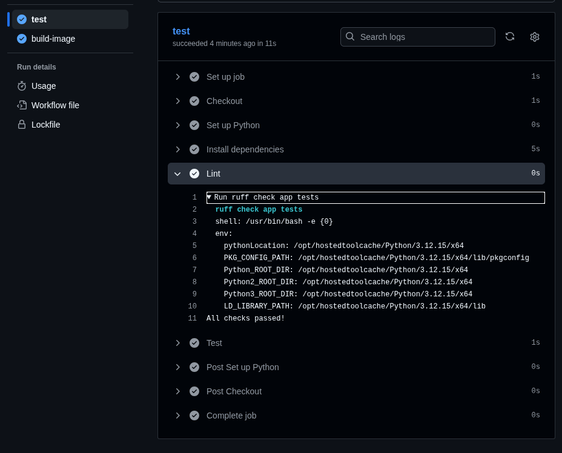
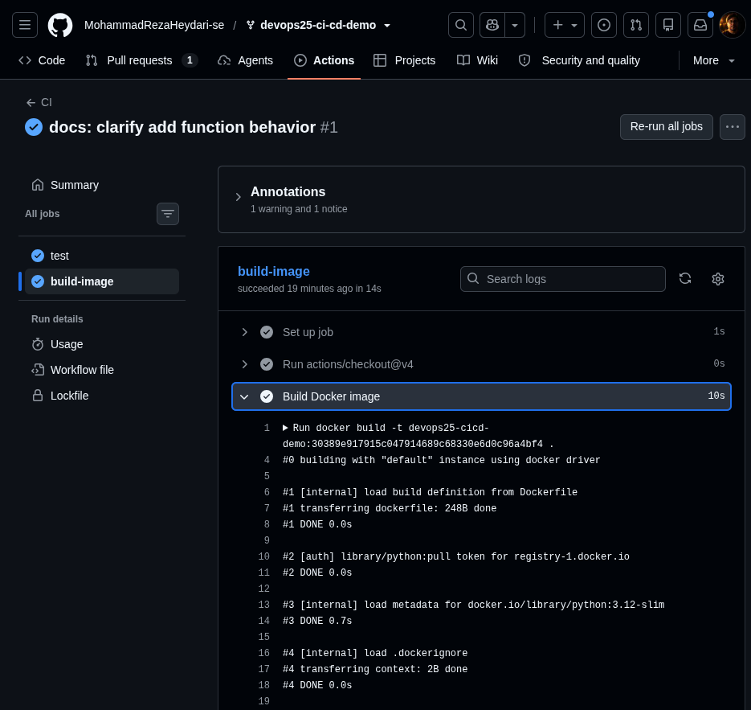
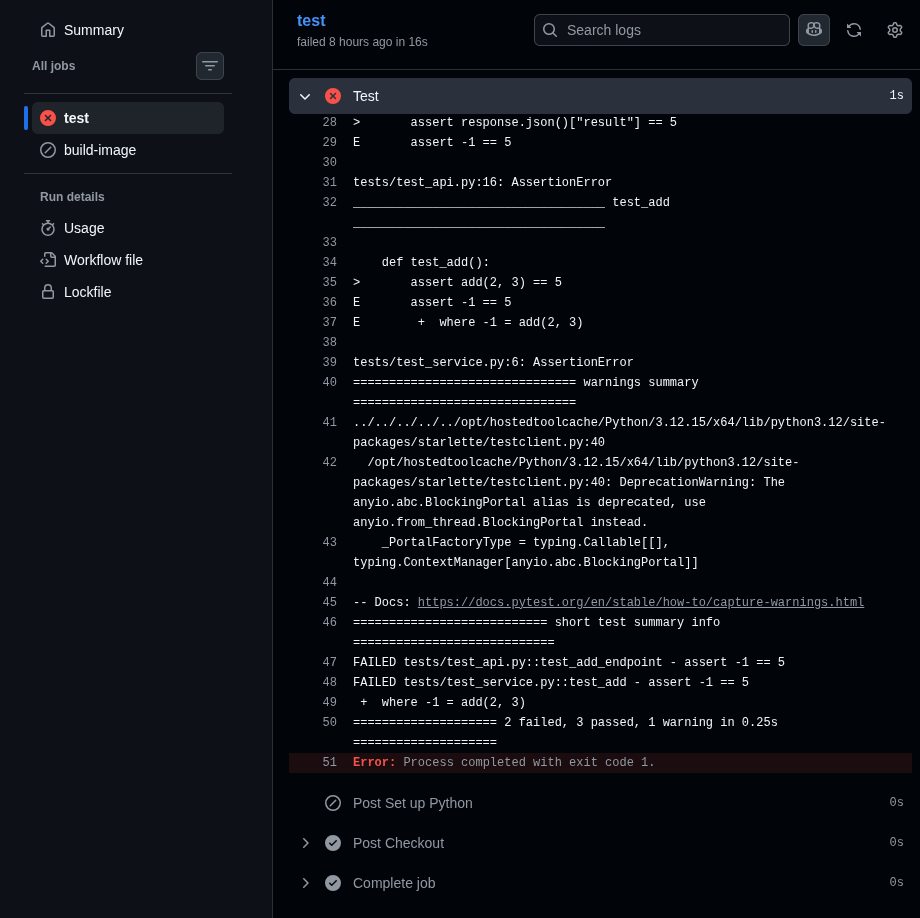
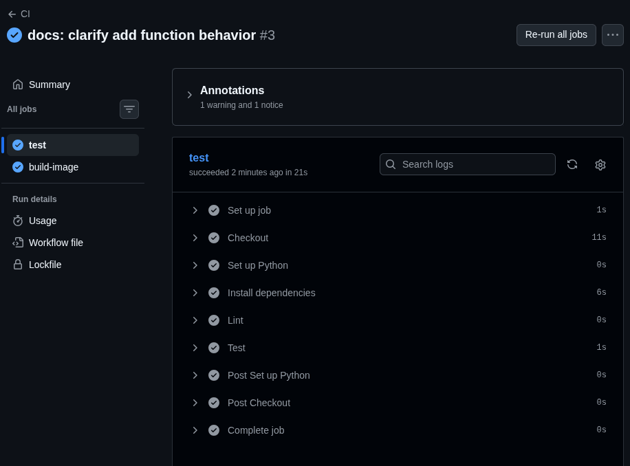

# Dag 2 – Praktisk CI-övning

## Syfte

Syftet med övningen var att se hur en CI-pipeline fungerar i praktiken. Jag ville undersöka vad som händer när koden fungerar, när ett fel uppstår och när felet rättas till.

## Genomförande

Jag arbetade i en egen branch, `exercise/day02-practical-MReza`, i mitt forkade repository.

Först gjorde jag en liten ändring i `app/service.py` och lade till en beskrivning av funktionen `add`. Jag körde Ruff och Pytest lokalt innan jag pushade ändringen. Alla fem tester gick igenom.

Jag skapade sedan en pull request mot `main` i mitt eget repository. När jag uppdaterade pull requesten startade GitHub Actions automatiskt.

### 1. Lyckad pipeline

Pipelinen körde lint med Ruff och tester med Pytest. När testerna var godkända byggdes en Docker-image.

Jag öppnade loggarna för att se vad som faktiskt kördes, inte bara om resultatet var grönt.





### 2. Avsiktligt fel

För att se hur pipelinen reagerade på ett fel ändrade jag funktionen `add` så att den subtraherade talen i stället för att addera dem.

Jag ändrade `return a + b` till `return a - b`.

Ruff hittade inga problem, men Pytest upptäckte att resultatet blev fel. Två tester misslyckades:

- `tests/test_service.py::test_add`
- `tests/test_api.py::test_add_endpoint`

Båda förväntade sig resultatet `5`, men fick `-1`.

I testloggarna såg jag felmeddelandet:

```text
assert -1 == 5
2 failed, 3 passed
```

Jag följde felet tillbaka till `app/service.py`, där jag hade ändrat operatorn från plus till minus.

Jobbet `build-image` kördes inte eftersom workflow-filen använder `needs: test`. Det innebär att bygget bara fortsätter om testjobbet lyckas.



### 3. Rättning och kontroll

Jag ändrade tillbaka funktionen till `return a + b` och körde Ruff och Pytest igen. Alla fem tester gick igenom.

Efter att jag commitat och pushat rättningen kördes CI-pipelinen automatiskt igen. Både `test` och `build-image` lyckades.



## Reflektion

Jag lärde mig att en grön lint-kontroll inte betyder att programmet fungerar korrekt. Ruff hittade inga problem, men Pytest upptäckte felet i beräkningen.

Samma fel påverkade både ett enhetstest och ett API-test. Genom att läsa loggarna kunde jag hitta grundorsaken i `app/service.py`.

Pipelinen kontrollerade den funktionalitet som täcktes av testerna, men den kunde inte garantera att hela applikationen var felfri. Den kontrollerade inte heller någon riktig driftsättning.

Snabb feedback är viktig eftersom det blir lättare att hitta och rätta fel nära den ändring som orsakade problemet.

## GitHub Actions och commits

- [Pull request i mitt repository](https://github.com/MohammadRezaHeydari-se/devops25-ci-cd-demo/pull/1)
- [Misslyckad CI-körning](https://github.com/MohammadRezaHeydari-se/devops25-ci-cd-demo/actions/runs/41622795290)
- [Lyckad CI-körning efter rättning](https://github.com/MohammadRezaHeydari-se/devops25-ci-cd-demo/actions/runs/41704482858)
- Avsiktligt fel: `8ef6c66`
- Rättning: `45f6336`

## Slutsats

Övningen hjälpte mig att förstå hur GitHub Actions, Ruff, Pytest och Docker fungerar tillsammans i en CI-pipeline. Framför allt fick jag öva på att undersöka loggar, hitta orsaken till ett fel och kontrollera att lösningen fungerar.
